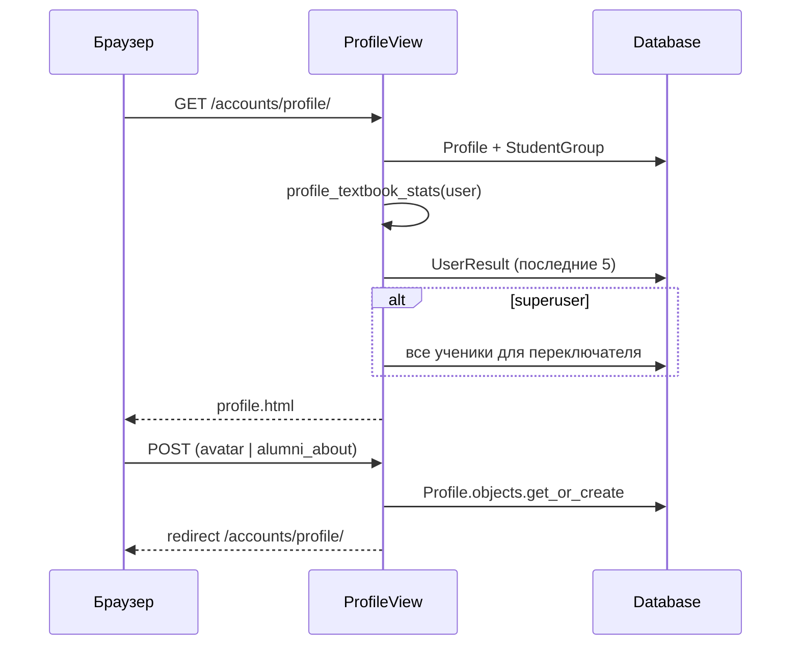

# Accounts API

Приложение `accounts` предоставляет 2 endpoint'а профиля и `AlumniView`, который
подключён в корневом `config/urls.py` по адресу `/alumni/`. Всё остальное под
`/accounts/` – стандартные Django auth views.

---

## Endpoints

### GET/POST `/accounts/profile/` – Свой профиль

**View:** `ProfileView` (`LoginRequiredMixin`, `generic.TemplateView`)
**Auth:** `LoginRequiredMixin`
**Template:** `registration/profile.html`

Профиль собирается вокруг двух вещей: как человек учится (блок **Учебник** из
`textbook.services.profile_textbook_stats`) и что он делал в тренажёре ЕГЭ.
Прогресс по номерам ЕГЭ намеренно живёт не здесь, а на вкладке «Мой прогресс»
тренажёра: две страницы с одними и теми же цифрами неизбежно расходятся.

**Контекст шаблона:**

| Переменная | Тип | Описание |
|------------|-----|----------|
| `profile_user` | User | Чей профиль показывается |
| `profile` | Profile | Профиль (может быть None) |
| `group` | StudentGroup | Группа (может быть None) |
| `is_own` | bool | Свой ли это профиль |
| `is_ege` | bool | Готовится ли ученик к ЕГЭ |
| `textbook` | dict | Статистика по учебнику (`profile_textbook_stats`) |
| `recent_results` | list[UserResult] | Последние 5 сданных тестов |
| `students` | QuerySet | Переключатель учеников – только суперпользователю |

**POST** – две формы на странице, различаются по полю: если в теле есть
`alumni_about`, сохраняется карточка выпускника (`alumni_place`, `alumni_about`),
иначе принимается файл аватара. Аватар прогоняется через `AvatarForm`
(`ModelForm` – ради валидации Pillow), лимит 2 МБ; старый файл удаляется после
успешного `save()`. Править можно только свой профиль: учитель чужой не трогает.

Поле `easter_egg` (+ `on=0|1`) – переключатель найденной пасхалки в разделе
«Пасхалки» (`accounts/easter_eggs.py`, `switch`): ненайденную так не открыть.
Карточка шлёт его `fetch` с заголовком `X-Requested-With: fetch` и получает 204,
без JS – редирект на `#easter-eggs`. Карточки (`easter_egg_cards`) есть только в
своём профиле. Суперпользователю в своём профиле под карточками – свёрнутый
«Предпросмотр всех видов» (`easter_egg_preview`): у каждой пасхалки закрытая
карточка (`hint`), открытая (`title`, `blurb`) и тост находки (`toast`), чтобы
вычитывать тексты и картинки, не открывая пасхалки заново.

---

### POST `/accounts/easter-eggs/<key>/found/` – Секрет пасхалки выполнен

**View:** `easter_egg_found_view` · **Auth:** `login_required`, только POST, CSRF

Страница, где выполнен секрет, сообщает о нём: `unlock` открывает пасхалку и
включает её **один раз** – повтор не включает обратно выключенную в профиле.
Ответ – `{"new": bool, "title": …, "image": …, "toast": …}` (тост показывается
только при `new`, его строка – `Egg.toast`, в шаблонах текста нет), неизвестный
ключ – 404. Секрет живёт в JS страницы и найдётся в исходнике: это игрушка, а не
защита, в статистику пасхалки не идут.

| Ключ | Секрет | Где |
|---|---|---|
| `brainrot` | 10 переключений задач за 15 с | `easterHunt`, `static/js/brainrot-feed.js` |
| `streak` | 3 задачи подряд верно с первой попытки | `streakFx`, `static/js/streak.js` |
| `zawarudo` | «Завершить» вручную, когда до конца работы ≤ 30 с | `zaWarudoHunt`, `static/js/za-warudo.js` |

---

### POST `/accounts/za-warudo/use/` – Остановить время

**View:** `za_warudo_use_view` · **Auth:** `login_required`, только POST, CSRF

Способность пасхалки `zawarudo` (`easter_eggs.use_za_warudo`). Поля `kind`
(`practice` – экзамен тренажёра или срез, `classwork` – самостоятельная,
`variant` – вариант ЕГЭ) и `id` (сессия, попытка или вариант). Сервер реально
сдвигает дедлайн: `PracticeSession.frozen_seconds += N`,
`ClassworkAttempt.deadline += N`; у варианта таймер в браузере, сервер только
требует, чтобы вариант был начат (`ege_<id>_start` в сессии). N = 15 с, каждое
применение +3 с, потолок 60 с; перезарядка сутки, профиль под
`select_for_update`. Суперпользователю не нужны ни пасхалка, ни перезарядка.

Ответ `{"seconds", "deadline", "next_seconds", "ready_at"}`; 403 – пасхалка
выключена или учитель не разрешил (`Quiz.za_warudo_allowed`, срез и
самостоятельная), 404 – работа не найдена или чужая, 409 – перезарядка
(`{"error": "cooldown", "ready_at"}`) или работа не идёт.

---

### GET/POST `/accounts/profile/<user_id>/` – Профиль ученика

**View:** тот же `ProfileView`
**Auth:** `LoginRequiredMixin` + `is_superuser` (иначе `PermissionDenied` → 403)

Тот же шаблон и тот же контекст, что у своего профиля, плюс переключатель
учеников. Чужой профиль открывает только суперпользователь – тот же критерий
«учителя», что и у отчётов по блокам учебника.

---

### GET `/alumni/` – Архив выпускных классов

**View:** `AlumniView` (`UserPassesTestMixin`, `generic.ListView`)
**Auth:** `is_superuser` (`test_func`), `raise_exception=True` → 403
**Template:** `accounts/alumni.html`
**Context object:** `groups`

Общее фото, слово учителя и карточки выпускников. Страница внутренняя: ссылки в
шапке сайта нет, вход только из учительской панели внутри профиля.

QuerySet – `StudentGroup` с заполненным `graduation_year`, ученики
предзагружены через `Prefetch`, сортировка `-graduation_year, name`. Группа
самого раннего выпуска получает флаг `is_first`; год в код не зашит.

---

### GET/POST `/accounts/join/` – Регистрация в классе по коду

**View:** `join_view` · **Form:** `JoinForm` (`UserCreationForm` + код)
**Auth:** не нужна; вошедшего редиректит на главную
**Template:** `accounts/join.html`

Ученик вводит код класса, ФИО, логин и пароль и сразу получает активный аккаунт
в классе: `Profile.group` и «Сдаёт ЕГЭ» по флагу класса `is_ege_class`.
Модерации нет – утёкший код безопаснее заменить. Код – 8 символов без похожих
(`StudentGroup.issue_join_code`, живёт `JOIN_CODE_DAYS` дней), учитель может
вписать свой в карточке класса: регистр, пробелы и дефисы не важны,
просроченный и неверный неразличимы.

Вход (`/accounts/login/`) перекрыт в `config/urls.py` формой `LoginForm`:
`ModelBackend` отбрасывает неактивного до пароля, поэтому форма сама проверяет
пароль неактивного и при верном говорит «учётная запись отключена».

---

## Django Auth URLs

Стандартные маршруты из `django.contrib.auth.urls` (8 штук под `/accounts/`):

| URL | Описание |
|-----|----------|
| `/accounts/login/` | Страница входа |
| `/accounts/logout/` | Выход |
| `/accounts/password_change/` | Смена пароля |
| `/accounts/password_change/done/` | Пароль изменён |
| `/accounts/password_reset/` | Запрос сброса пароля |
| `/accounts/password_reset/done/` | Письмо отправлено |
| `/accounts/reset/<uidb64>/<token>/` | Новый пароль по ссылке из письма |
| `/accounts/reset/done/` | Пароль сброшен |

!!! info "Регистрация"
    Самостоятельной регистрации на сайте нет: учётные записи заводит учитель в
    админке, там же `Profile` заполняется инлайном (`ProfileInline`). Если
    профиля у пользователя всё же нет, `ProfileView` создаёт его при первом POST.
