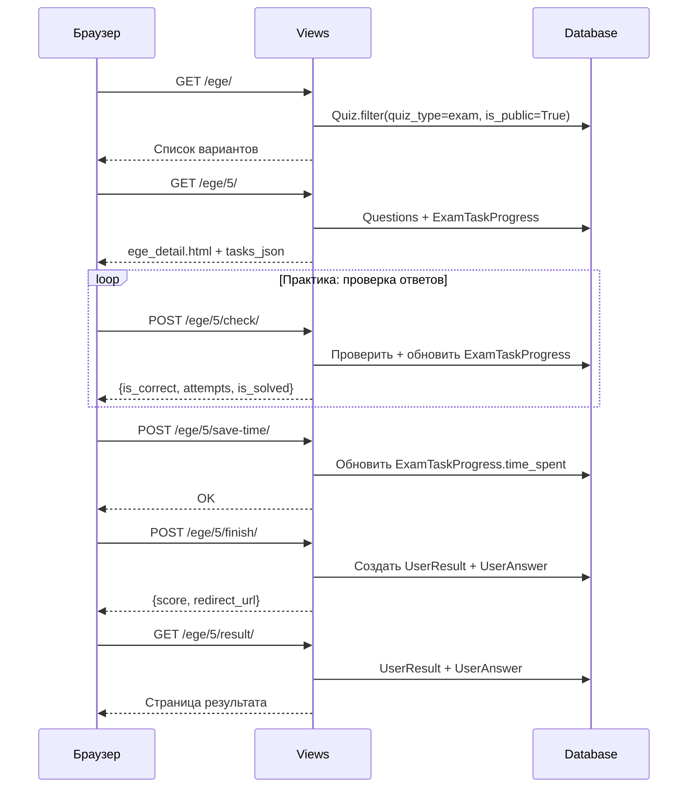

# EGE API

EGE-тренажёр смонтирован на `/ege/` (`quizzes/urls_ege.py`) и состоит из двух
подсистем, которые не пересекаются данными:

- **варианты** – собранная работа целиком, `Quiz(quiz_type='exam')`, прогресс в `ExamTaskProgress`;
- **тренировка по темам** – короткие сессии из банка задач, `Quiz(quiz_type='bank')`,
  журнал в `PracticeSession` / `PracticeItem`.

Разделение жёсткое: задача принадлежит одному квизу, поэтому вариант никогда не
вычерпывает тренировочную выдачу, а тренировка не попадает в статистику варианта.

Авторизация нужна везде, кроме двух страниц: `/ege/` (гостю хаб показывается с
демонстрационным прогрессом, `ege_stats.demo_overview`) и `/ege/task/<number>/`
(карточка задания – теория открыта всем, личная статистика на ней появляется
только у вошедшего).

---

## Основной flow



---

## Endpoints

### GET `/ege/` – Список вариантов

**View:** `ege_list_view`
**Template:** `quizzes/ege_list.html`

Показывает доступные EGE-варианты. Для каждого отображается прогресс пользователя.

---

### GET `/ege/<id>/` – Детали варианта

**View:** `ege_detail_view`
**Template:** `quizzes/ege_detail.html`

Основная страница EGE-варианта с навигацией по задачам.

**Логика:**

- **Exam mode:** если `UserResult` уже существует – redirect на результат (одна попытка)
- **Practice mode:** вопросы доступны для повторного решения
- Загружает `ExamTaskProgress` для каждого вопроса (solved, attempts, time)
- Для code-вопросов: последние сохранённые код и язык (`last_submissions_json`, без вердикта) + лучшие метрики
- Для text- и code-вопросов: восстанавливает последний ответ из `UserAnswer`
- Форма поля ответа – `answer_shape(question)`: таблица или одно поле

**`tasks_json` структура:**
```json
[
  {
    "id": 1,
    "ege_number": 1,
    "type": "text",
    "is_solved": true,
    "attempts": 3,
    "time_spent": 120,
    "saved_answer": "42",
    "shape": null,
    "points": 1
  },
  {
    "id": 5,
    "ege_number": 25,
    "type": "code",
    "is_solved": false,
    "attempts": 1,
    "time_spent": 300,
    "saved_answer": "",
    "shape": [1, 2],
    "best_cpu_time_ms": 45.2,
    "best_memory_kb": 8192,
    "best_cpu_code": "n = int(input())",
    "points": 2
  }
]
```

`shape` – `[строк, столбцов]` таблицы ответа или `null`, если хватает одного
поля. Считается по эталону (`ege_scoring.answer_shape`): таблица нужна, когда
в нём два и больше чисел (17, 18, 20, 25–27), – в том числе у текстовых задач
(задание 18 – два числа). В браузер уходит только форма, сами числа эталона
остаются на сервере. `last_submissions_json` несёт только `{code, language}`:
вердикт прошлого снимка был бы подсказкой. WebSocket здесь не подключается –
оценку даёт «Проверить ответ», а не вывод программы.

---

### POST `/ege/<id>/check/` – Проверить ответ

**View:** `ege_check_answer_view`
**Content-Type:** `application/json`

Мгновенная проверка ответа (`text`, `choice`, `code`). **Только в practice mode.**

**Запрос:**
```json
{"question_id": 5, "answer": "42", "code": "n = int(input())", "language": "python"}
```

`code` и `language` нужны только задаче с кодом: у неё оценивается **ответ**,
а код уходит снимком (`create_snapshot`) в фон и в оценке не участвует.

**Ответ (200):**
```json
{
  "is_correct": true,
  "attempts": 3,
  "is_solved": true
}
```

| Код | Причина |
|-----|---------|
| 400 | Пустой ответ, невалидный question_id или тип не из `text` / `choice` / `code` |
| 403 | Exam mode (проверка запрещена) |
| 404 | Вопрос не найден в этом тесте |

!!! tip "Как сверяется ответ"
    `ege_scoring.check_answer(question, answer)` – одна функция для сессии,
    варианта и снимка. Эталон – `expected_answer(question)`: у текстовой задачи
    `correct_text_answer`, у задачи с кодом – `output_data` её теста. Если
    в эталоне только числа (таблица), они сравниваются по порядку
    (`outputs_match`), поэтому «98 293» в строке и те же числа в двух строках
    – один ответ. У текстовой задачи дополнительно проверяется
    `alternative_answers`. У 26 и 27 `score` бывает частичным (0/1/2), но
    в этот ответ он не входит – балл держит `ExamTaskProgress`.

---

### POST `/ege/<id>/finish/` – Завершить вариант

**View:** `ege_finish_view`
**Content-Type:** `application/json`

Финализирует EGE-вариант: создаёт `UserResult` и `UserAnswer` для каждого вопроса.

**Запрос:**
```json
{
  "answers": {"1": "42", "3": "100"},
  "codes": {"5": "n = int(input())"},
  "languages": {"5": "python"},
  "force": false
}
```

`codes` и `languages` – для задач с кодом: из них создаются снимки, а оценивается
ответ из `answers`.

**Ответ (200):**
```json
{
  "success": true,
  "result_id": 20,
  "score": 15,
  "total_points": 28,
  "pending_checks": 0,
  "redirect_url": "/ege/5/result/"
}
```

**Логика:**

1. Exam mode: блокирует повторную сдачу (403 если `UserResult` существует)
2. Text- и code-вопросы: `check_answer()` по ответу из поля; у 26 и 27 балл
   частичный
3. Code-вопросы: `create_snapshot()` из `codes` пишет `CodeSubmission.answer`,
   `UserAnswer.text_answer` – ответ, `code_answer` – код снимка
4. Обновляет `ExamTaskProgress` по каждой отвеченной задаче
5. `pending_checks` всегда 0: снимки проверяются в фоне и на балл не влияют

---

### GET `/ege/<id>/result/` – Результат варианта

**View:** `ege_result_view`
**Template:** `quizzes/ege_result.html`

Показывает результат: набранные баллы, правильные/неправильные ответы. «На
проверке» здесь считаются только обычные отправки (`submission.answer IS NULL`):
снимки кода на балл не влияют, ждать их нечего.

---

### GET `/ege/<id>/results/` – Сводная таблица результатов

**View:** `ege_results_view`
**Template:** `quizzes/ege_results.html`

Сводная таблица результатов всех учеников по данному варианту.

**Колонки таблицы:**

| Колонка | Описание |
|---------|----------|
| Участник | Имя ученика; для суперпользователя – ссылка на детальную статистику |
| №1 … №N | Результат по каждой задаче (✓ / ✗ / –), клик → решение |
| ✓ | Количество правильных ответов |
| Баллы | Первичный балл (сумма `question.points`) |
| Тест | Тестовый балл по шкале ЕГЭ 2024 (`EGE_SCORE_CONVERSION`) |
| Время | Суммарное время ученика на весь вариант |

---

### GET `/ege/<id>/results/student/<user_id>/` – Статистика ученика

**View:** `ege_student_stats_view`
**Template:** `quizzes/ege_student_stats.html`
**Доступ:** только суперпользователь (иначе 403)

Детальная статистика конкретного ученика по варианту: время, попытки, статус, CPU и память по каждой задаче.

**Карточки-итоги:** всего задач / решено / всего попыток / общее время.

---

### POST `/ege/<id>/save-time/` – Сохранить время

**View:** `ege_save_time_view`
**Content-Type:** `application/json`

Периодически сохраняет время, потраченное на текущую задачу.

**Запрос:**
```json
{"question_id": 1, "time_spent": 120}
```

---

### Решения других – `/quizzes/`

Галерея решений висит на задаче (`Question`), а не на ответе: одна задача – одна
галерея, откуда бы ученик её ни решал. Маршруты – `quizzes/urls.py`, вьюхи –
`quizzes/views_solutions.py`, правила доступа и подписи – `quizzes/solutions.py`.
Старый адрес `/ege/<id>/task/<num>/solution/<user_id>/` (`ege_solution_detail_view`)
остался редиректом на галерею задачи: `user_id` в адресе выдавал бы автора тем,
кому имени видеть не положено. Прежние `ege_upload_attachment_view` и
`ege_toggle_like_view` заменены четырьмя маршрутами ниже.

---

### GET `/quizzes/question/<question_id>/solutions/` – Галерея задачи

**View:** `views_solutions.solutions_view`
**Template:** `quizzes/solutions.html`

Открывается тому, кто сам верно решил задачу (полный балл), и суперпользователю:
чужая работа – награда, а не подсказка (`solutions.can_view`). Карточка на автора:
код – последняя верная отправка и рекорды по CPU и памяти, плюс разбор
(комментарий, картинка, файл), лайки и подпись автора (`solutions.name_visible`).
Скрытое учителем ученик не видит (своё – видит с пометкой). Сортировка – `?sort=`
(`likes` по умолчанию, `cpu`, `memory`; у текстовых задач только `likes`).

---

### POST `/quizzes/question/<question_id>/solutions/mine/` – Своё решение

**View:** `views_solutions.my_solution_view`
**Content-Type:** `multipart/form-data`

Своя запись `SharedSolution` – одна на пару (автор, задача). Доступна по решённой
задаче, иначе – сообщение и редирект в галерею.

| Поле | Тип | Описание |
|------|-----|----------|
| `name_visibility` | string | `''` – как в профиле, иначе `anon`, `class`, `all` |
| `comment` | string | Разбор |
| `file` | File | Файл, до 20 МБ (`txt`, `csv`, `ods`, `odt`, `xlsx`, `doc`, `docx`, `pdf`, `py`, `cpp`) |
| `image` | File | Картинка, до 5 МБ (`jpg`, `jpeg`, `png`, `gif`, `webp`) |

Поля `remove_file` / `remove_image` убирают вложение.

---

### POST `/quizzes/solution/<solution_id>/like/` – Лайк

**View:** `views_solutions.like_view`
**Content-Type:** `application/json`

Toggle лайка на `SharedSolution`. Лайкать можно то, что видно: своё решение –
403, нерешённая задача – 403, скрытое учителем – 404. Повторный запрос убирает
лайк.

**Ответ:**
```json
{"liked": true, "like_count": 5}
```

---

### POST `/quizzes/solution/<solution_id>/moderate/` – Модерация

**View:** `views_solutions.moderate_view`
**Доступ:** только суперпользователь

Учитель переключает `field=hidden` (скрыть решение целиком) или
`field=notes_hidden` (код виден, комментарий, картинка и файл – нет) и
возвращается в галерею задачи.


---

## Тренировка по темам

Сессия – короткая пачка задач, отобранная под одну цель. Отбором занимается
`quizzes/ege_practice.py`, статистикой – `quizzes/ege_stats.py`, вьюхи лежат
в `quizzes/views_practice.py`.

```mermaid
sequenceDiagram
    participant B as Браузер
    participant V as views_practice
    participant P as ege_practice
    participant DB as Database

    B->>V: POST /ege/practice/start/
    V->>P: build_session(kind, mode, size, mix)
    P->>DB: отбор из банка + expand_groups (19–21)
    P-->>V: PracticeSession + PracticeItem[]
    V-->>B: redirect /ege/practice/<pk>/

    loop Решение
        B->>V: POST /ege/practice/<pk>/answer/\n{answer, code, language}
        V->>V: check_answer(question, answer)
        V->>DB: PracticeItem.is_correct, attempts, score
        opt задача с кодом в тренировке
            V->>DB: create_snapshot → Celery
        end
        V-->>B: study – вердикт; exam – только {saved: true}
        B->>V: POST /ege/practice/<pk>/time/
    end

    B->>V: POST /ege/practice/<pk>/finish/\n(код экзамена – полем codes)
    V-->>B: redirect /ege/practice/<pk>/result/
```

### GET `/ege/task/<number>/` – Карточка задания

**View:** `views_practice.ege_task_view` · **Template:** `quizzes/ege_task.html`

Теория по заданию, личная статистика и форма запуска сессии. Связка 19–21
живёт одной страницей: `/ege/task/20/` и `/21/` редиректят на `/ege/task/19/`.

### POST `/ege/task/<number>/classroom/` – Рубильник «Задачи для урока»

**View:** `views_practice.classroom_toggle_view` · **Только суперпользователь**

Переключает `EgeTask.classroom_enabled`. Пока выключен, ученик не видит кнопку,
а прямой POST на старт отклоняется.

### GET `/ege/task/<number>/solved/` – Решённые задачи

**View:** `views_practice.ege_solved_view` · **Template:** `quizzes/ege_solved.html`

Решённые задачи вместе с ответом или кодом ученика и лучшими метриками
(`ege_practice.best_code_metrics` – минимум CPU и памяти по верным отправкам).

### GET/POST `/ege/task/<number>/bank/` – Банк задач

**View:** `views_practice.ege_bank_view` · **Только суперпользователь**

Весь банк одного задания с условием, отрисованным как у ученика, и раскладкой
по трём пулам: тренировка / в классе (`classroom_only`) / экзамен (`exam_only`).
Сохранение – одним `bulk_update`; связка 19–21 переезжает целиком.

### POST `/ege/practice/start/` – Старт сессии

**View:** `views_practice.practice_start_view`

| Поле формы | Значения |
|------------|----------|
| `kind` | `topic` / `mistakes` / `mixed` / `classroom` |
| `mode` | `study` / `exam` |
| `ege_number` | 1–27, обязателен для `topic` и `classroom` |
| `difficulty` | 1 / 2 / 3 – простая выборка по сложности |
| `size` | 1–`STUDY_MAX_SIZE`; у связки – число троек |
| `mix_1` / `mix_2` / `mix_3` | Ручной состав по сложности |

Неизвестные `kind` и `mode` молча падают к `topic` и `study`; `size` обрезается
до `STUDY_MAX_SIZE`, а для связки 19–21 умножается на длину группы – форма
спрашивает тройки, отбору нужны задачи.

Серверные проверки: экзамен закрыт, пока не решено `EgeTask.exam_unlock_threshold`
разных задач в режиме `study`; одновременно идёт не больше одного экзамена
(второй POST вернёт в уже идущую сессию); `classroom` ученику отклоняется, пока
выключен `EgeTask.classroom_enabled`. Пустой отбор – не ошибка, а редирект
на карточку задания с флагом в сессии.

### POST `/ege/practice/retry/<question_id>/` – Переписать решение

**View:** `views_practice.practice_retry_view`

Сессия `kind='retry'` из одной задачи на коде. Не оценивается: провал не
переводит задачу в нерешённые, замка на повторные отправки нет, в статистику
и в счётчик открытия экзамена не идёт.

### GET `/ege/practice/<pk>/` – Страница сессии

**View:** `views_practice.practice_view` · **Template:** `quizzes/ege_practice.html`

Одна задача на экране. **Правильные ответы в браузер не уходят** ни в одном
режиме – их отдаёт только `/reveal/`. В `items_json` у каждой задачи есть
`shape` – форма таблицы ответа `[строк, столбцов]` или `null` (одно поле);
`last_submissions_json` несёт только `{code, language}`, без вердикта. У
экзамена страница получает `seconds_left`, посчитанный на сервере.

### POST `/ege/practice/<pk>/answer/` – Ответ на задачу

**Content-Type:** `application/json` · `{"item_id": 12, "answer": "42", "seconds": 40, "code": "...", "language": "python"}`

`code` и `language` – только для задачи с кодом: оценку даёт `answer`
(`ege_scoring.check_answer`), а код уходит снимком.

- `mode='study'` – `{"is_correct", "score", "item_id", "attempts", "locked"}`;
  верный ответ не отдаётся
- `mode='exam'` – `{"saved": true, "item_id"}`, ни исхода, ни намёка на него
- Решённая или открытая задача – 409; завершённая сессия – 403

### POST `/ege/practice/<pk>/reveal/` – «Показать ответ»

Только в `study`. Ставит `gave_up`, закрывает задачу как нерешённую и лишь
после этого отдаёт `correct_answer`. Цена подсказки равна цене неверного ответа.

### POST `/ege/practice/<pk>/time/` – Досылка времени

Порция обрезается `MAX_SECONDS_PER_REPORT` (600 с): цифры идут в отчёт учителю.

Часы задачи останавливает **браузер**: после верного ответа или «Показать ответ»
время больше не шлётся (в повторе `kind='retry'` – шлётся). На сервере заморозки
нет намеренно: порция уходит отдельным `fetch` прямо перед проверкой, и сервер,
отбрасывающий время закрытой задачи, терял бы её, когда проверка пришла первой.

### POST `/ege/practice/<pk>/finish/` – Завершение

Поле `beacon=1` – уход с экзамена через `sendBeacon`: недосланные ответы
(`answers`, до 100 штук) сохраняются и сессия закрывается одним запросом,
ответ 204. Обычный POST – редирект на разбор.

Код экзамена приходит полем формы `codes` = JSON
`{item_id: {code, language}}` – по нему создаются снимки, ответ берётся из
`PracticeItem.text_answer`. До завершения код лежит только в `localStorage`
браузера. Коды принимаются и в течение `EXAM_CODES_GRACE` = 2 минуты после
дедлайна (страница жмёт «Завершить» на нуле, а сессию уже закрыл по часам
`_owned_session`); ответы после дедлайна не принимаются.

### GET `/ege/practice/<pk>/result/` – Разбор сессии

Открывается **только у завершённой сессии**: иначе страница разбора работала бы
второй вкладкой с верными ответами посреди экзамена. Незакрытая сессия –
редирект обратно на `/ege/practice/<pk>/`.

---

## Учительские страницы

### GET `/ege/class/` – Сравнительная таблица класса

**View:** `ege_class_view` · **Только суперпользователь**

Строка на ученика: прогноз балла и на скольких заданиях он держится, последний
экзаменационный вариант, долг по ошибкам, три самые дорогие дыры, график
активности по неделям. Один класс за раз (`?group=<id>`, `all`, `none`).
`ege_stats.class_rows()` считает весь класс семью запросами.

### GET `/ege/student/<user_id>/mistakes/` – Долг ученика

**View:** `ege_student_mistakes_view` · **Только суперпользователь**

Тот же набор задач, что ученик получит по кнопке «Работа над ошибками», но в
режиме чтения: условие, ответ ученика, лог ошибки и панель с верным ответом.
Не сессия – чужую сессию открыть и «просто посмотреть» нельзя.

### GET `/ege/task/<number>/similar/` – Похожие решения

**View:** `views_similarity.ege_similar_view` · **Только суперпользователь**
(у теста – `/quizzes/<id>/similar/`, ссылка из отчёта по блоку учебника)

Пары учеников, чей код задачи совпадает сильнее `similarity.SHOW_FROM` (60 %).
Код → нормализованные токены (имена – `V`, числа – `N`, строки – `S`), Жаккар
по 5-граммам; фрагменты, которые есть больше чем у половины различных
программ, выбрасываются. Сравнивается первое верное решение ученика на каждом
языке. Связка 19–21 – одна страница. Вкладки классов – `_class_filter`.
Считается при открытии, без кэша: O(n²) по решившим одну задачу.

### GET `/ege/?student=<id>` – Чужой прогресс

Тот же хаб с цифрами ученика (`views._viewed_student`). Отдельного шаблона нет
намеренно: вторая вёрстка тех же чисел – второе место для расхождений.

---

## Два режима EGE

| Аспект | Exam Mode | Practice Mode |
|--------|-----------|---------------|
| Попытки | Одна | Без ограничений |
| Проверка `/check/` | Запрещена (403) | Доступна |
| Навигация | Линейная | Свободная |
| ExamTaskProgress | Обновляется при finish | Обновляется при каждой проверке |
| Таймер | Обратный отсчёт | Прямой отсчёт |

Внутри тренировки по темам режимы называются так же, но означают другое:

| Аспект | `mode='exam'` | `mode='study'` (в UI «Тренировка») |
|--------|---------------|------------------------------------|
| Проверка | Молча до конца сессии | Сразу после каждого ответа |
| Повторная попытка | Ответ правится как черновик | Новая попытка, растёт `attempts` |
| «Показать ответ» | Нет | Есть, ставит `gave_up` |
| Лимит времени | `EXAM_MINUTES` от `created_at` | Нет |
| Состав | Отбирает сервер, форма игнорируется | Задаёт ученик |
| Открыт | После `exam_unlock_threshold` решённых задач | Всегда |

## Частичный балл (задания 26 и 27)

`quizzes/ege_scoring.py` – единственное место, знающее правила ФИПИ. С КИМ-2027
у обоих заданий одно правило: ответ – два числа, 1 балл за перестановку или
одну верную ячейку. Сравниваются числа, а не раскладка вывода, поэтому
`43656 36` и те же числа в две строки – один ответ. Балл попадает в
`PracticeItem.score`, `UserAnswer.score` и `ExamTaskProgress.score`; у снимка
тренажёра `CodeSubmission.score` всегда `null`, а поле заполняется только
у обычной отправки практикума. Везде остальное – `null`.

Там же живут три функции, на которых держится оценка по ответу:
`expected_answer(question)` – эталон (у задачи с кодом это `output_data` её
теста), `answer_shape(question)` – форма таблицы ответа и
`check_answer(question, answer)` – сверка и балл. Задачу с кодом в тренажёре
оценивает ответ; вывод программы проверяется только у снимка и только на
«отработало ли».
