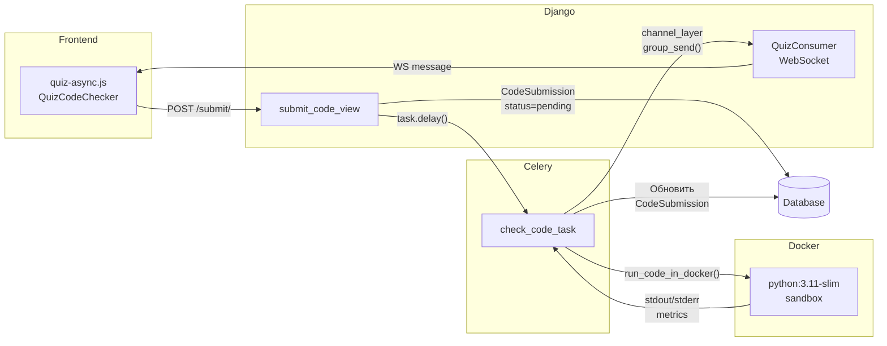
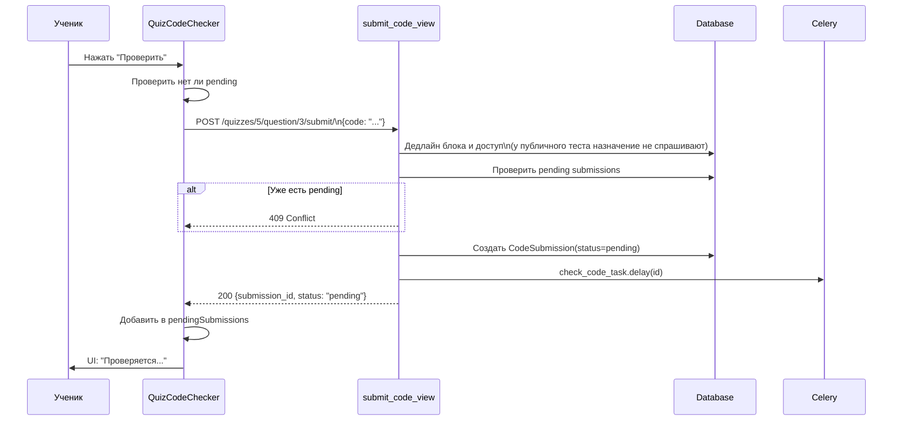
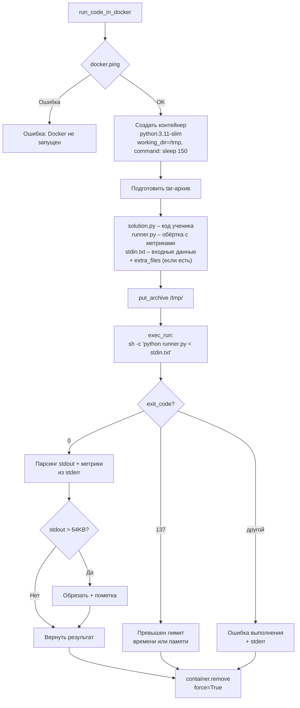
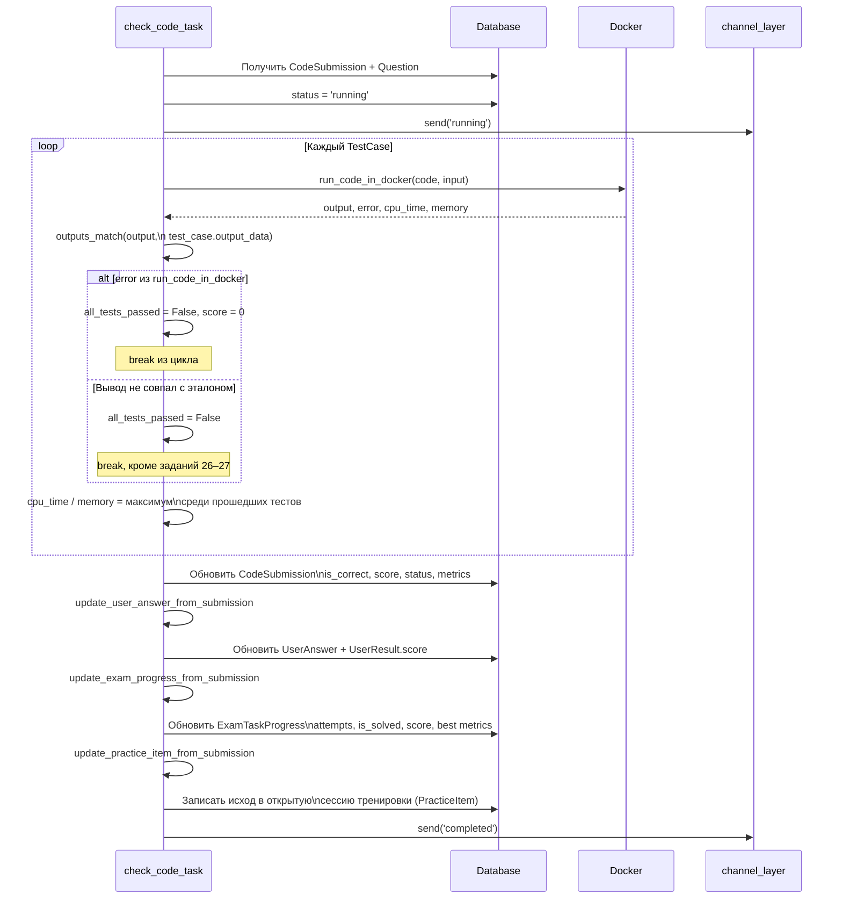
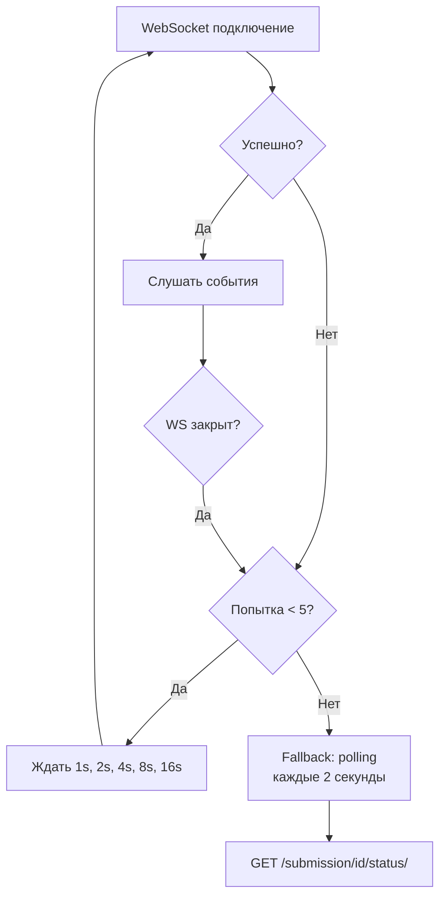
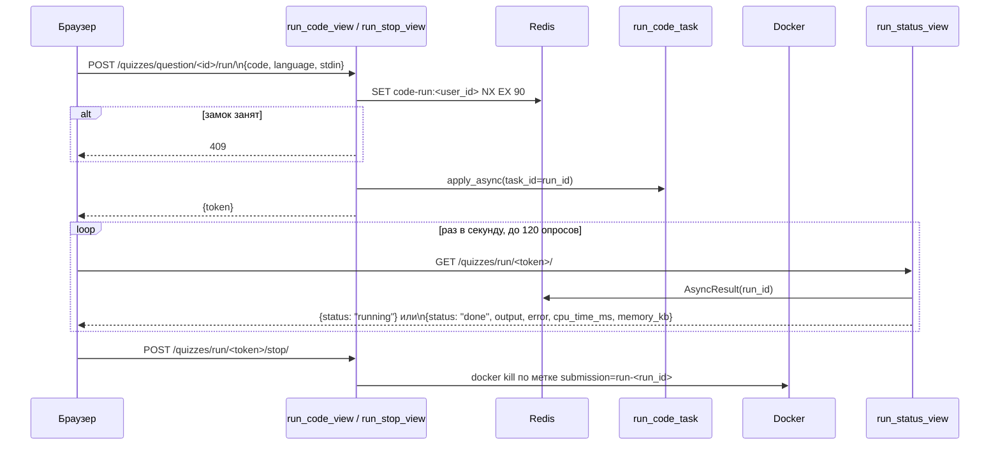
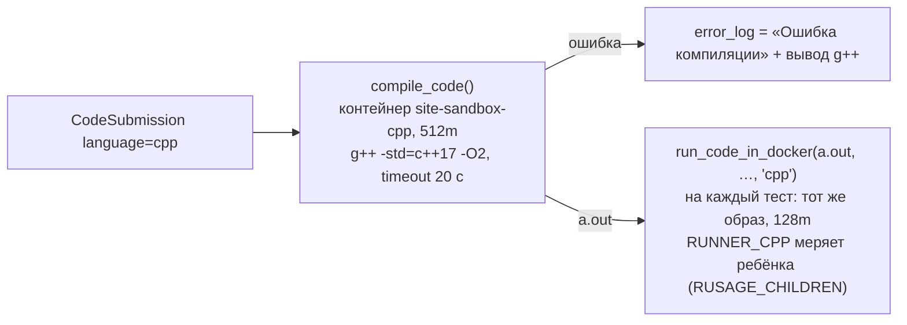

# Выполнение кода

Async pipeline: клиент → Django → Celery → Docker → WebSocket → клиент.

!!! note "Тренажёр ЕГЭ оценивает ответ, а не вывод"
    В тренажёре ЕГЭ этот путь используется только для двух вещей: «Запустить»
    (`run_code_task`, без записи в базу) и фоновый прогон **снимка**
    (`CodeSubmission` с непустым `answer`). Задачу там оценивает ответ в поле
    или таблице (`ege_scoring.check_answer`), а не вывод программы. Обычная
    отправка ниже – практикум учебника и прочие квизы, где задача
    засчитывается по тестам.

---

## Общая архитектура



---

## Отправка кода (Frontend → Backend)



---

## Docker Sandbox

### Ресурсные лимиты

| Параметр | Значение | Описание |
|----------|----------|----------|
| `CONTAINER_TIMEOUT` | 120 сек | Максимальное время жизни контейнера |
| `CONTAINER_MEM_LIMIT` | 128 MB | Лимит оперативной памяти (cgroup) |
| `CONTAINER_CPU_QUOTA` | 100000 | 100% одного ядра CPU (cgroup) |
| `CONTAINER_PIDS_LIMIT` | 64 | Потолок числа процессов: `os.fork()` в цикле выедает таблицу процессов сервера, а не контейнера |
| `CONTAINER_FSIZE_LIMIT` | 64 МБ | Потолок на один файл, который пишет решение (`RLIMIT_FSIZE` в раннере) |
| `OUTPUT_MAX_BYTES` | 64 KB | Максимальный размер stdout |
| Network | Отключена | `network_disabled`: не выкачать и не выложить наружу, `pip` тоже не работает |

Ограничения прав собраны в `CONTAINER_SECURITY`:

| Ключ | Значение | Зачем |
|------|----------|-------|
| `user` | `nobody` | Запись только в свой каталог, не в `/etc` и не в корень |
| `cap_drop` | `ALL` | Ни одной capability, даже из дефолтного набора Docker |
| `security_opt` | `no-new-privileges` | setuid-бинарь не поднимет права обратно |
| `network_disabled` | `True` | Сети нет |

Рабочий каталог – `/tmp` (`CONTAINER_WORKDIR`), а не `/app`: каталог из `working_dir` принадлежит root с правами 755, и от `nobody` в нём не создать файл – задачи «запиши результат в файл» перестали бы решаться. У `/tmp` в образе права 1777.

Внутри песочницы ученику позволено всё, что позволено Python: создать файл, прочитать его, запустить процесс. Значение имеет не запрет действий, а их потолок – запрещать `execve` бессмысленно, `solution.py` и так исполняется целиком.

### Процесс выполнения



### Runner Script (runner.py)

Обёртка, которая выполняет код ученика и собирает метрики:

```
1. Игнорировать SIGXFSZ и поставить RLIMIT_FSIZE – потолок на файл, который пишет решение
2. Прочитать stdin (файл `stdin.txt`, поданный на вход шеллом) и подменить его на StringIO
3. Запомнить пиковую память интерпретатора до запуска решения
4. Перехватить stdout → StringIO
5. exec(solution.py, {'__name__': '__main__'})
6. Вывести stdout ученика в настоящий stdout
7. stderr: __CPU_TIME_MS__:45.123
8. stderr: __MEMORY_KB__:8192
```

Метрики:
- **CPU time** – `time.process_time()` (только CPU, не wall-clock)
- **Memory** – `resource.getrusage(RUSAGE_SELF).ru_maxrss` минус пик интерпретатора до запуска решения (пиковое RSS, Linux, КБ)

Потолок `RLIMIT_FSIZE` стоит на один файл: тысяча файлов по чуть-чуть его обойдёт, суммарную квоту дал бы только `storage_opt` на xfs/pquota, которого на обычном overlay2 нет. `SIGXFSZ` глушится намеренно – без этого процесс умирал бы молча, а так ученик видит привычную ошибку «File too large».

---

## Celery Task Pipeline



Задача на код выполняется в очереди `code_execution` – маршрут задан в `task_routes` (`config/celery.py`), поэтому проверку кода можно развести с остальными задачами по разным воркерам.

### Зачёт задачи

Задача засчитана, только если прошли **все** тест-кейсы: тест-кейсы – это разные входы одной задачи, а не варианты записи одного ответа. Первый же провал прекращает проверку и попадает в `error_log` (плюс к нему – вывод ученика и входные данные, но не эталон).

Исключение – задания 26 и 27 (`ege_scoring.is_partial_task`): неверный ответ там ещё может стоить 1 балла, поэтому прогоняются все тесты, а баллом становится **худший** из них (`grade()`). Решённой такая задача считается только при полном балле (`score >= question.points`) – частичный балл остаётся в работе над ошибками, а в статистику идёт половиной верного ответа.

Метрики берутся по худшему из прошедших тестов (`max` по времени и по памяти), а не по одному удачному запуску: иначе решение выглядело бы лучше, чем есть. Если задача не засчитана, метрики не сохраняются вовсе (`cpu_time_ms` и `memory_kb` остаются пустыми).

### Режим снимка

Снимок – это `CodeSubmission` с непустым `answer`, созданный
`tasks.create_snapshot` из тренажёра ЕГЭ. Задачу там уже оценил ответ
(`ege_scoring.check_answer`), поэтому та же `check_code_task` работает иначе:

- тесты запускаются ради времени, памяти и ответа «программа отработала без
  ошибки», но вывод с эталоном **не** сравнивается: решение задания 2 честно
  печатает таблицу истинности;
- `is_correct` = ответ верный **и** все тесты завершились без ошибки и
  таймаута;
- `score` всегда `None` – балл у снимка живёт в `PracticeItem`, `UserAnswer` и
  `ExamTaskProgress`, а не в отправке;
- исход задачи снимок не меняет: `update_user_answer_from_submission` и
  `update_practice_item_from_submission` для него сразу выходят, а
  `update_exam_progress_from_submission` берёт только рекорды
  (`best_cpu_time_ms` / `best_memory_kb` и код).

Снимки питают «Решения других», «Похожие решения» и `best_code_metrics`.
Пустой код снимка не создаёт – ответ без кода законен; тот же код, язык и ответ
подряд второй раз не сохраняется.

### Обновление результатов

После проверки кода Celery task обновляет связанные записи. Для снимка первые
две функции сразу выходят, третья берёт только рекорды – исход задачи записал
ответ.

**update_user_answer_from_submission:**
1. Найти `UserAnswer` связанный с `CodeSubmission`
2. Обновить `is_correct`, `score`, `error_log`, `code_answer`
3. Пересчитать `UserResult.score` под `select_for_update` – тест мог быть закрыт, пока проверка ещё шла:
   - Standard: count distinct correct questions
   - Exam: сумма баллов; там, где балл частичный (26 и 27), берётся `answer.score`, иначе `question.points` за верный ответ
4. Для самопроверки учебника – `update_article_mastery`: пройденная самопроверка помечает статью «освоено»

**update_exam_progress_from_submission** (выходит сразу, если `quiz_type != 'exam'`):
1. Найти/создать `ExamTaskProgress`
2. Пока задача не решена – `attempts_to_solve += 1`. После решения счётчик замирает: он показывает, с какой попытки задача взята, а не сколько раз ученик потом переписывал решение
3. Частичный балл (26 и 27) – держится лучший: неудачная вторая попытка не должна отнимать уже заработанное
4. Обновить `is_solved`, `first_solved_at`
5. Обновить лучшие метрики (меньше = лучше), если лучше предыдущих:
   - `best_cpu_time_ms` + `best_cpu_code`
   - `best_memory_kb` + `best_memory_code`

**update_practice_item_from_submission:**
Записывает исход в **незавершённую** сессию тренировки ученика с этой задачей: `attempts += 1`, дальше `is_correct` и `score`. Провал сюда тоже попадает – по последнему исходу собирается работа над ошибками. Закрытую задачу (`PracticeItem.is_locked`) повторная отправка не меняет: счётчик попыток и отказ от задачи должны остаться такими, как были. В сессии `kind='retry'` записывается только успех – неудачный эксперимент не переводит уже решённую задачу в нерешённые.

---

## WebSocket обновления

### QuizConsumer

| Событие | Payload | Когда |
|---------|---------|-------|
| `submission_update` | `{submission_id, question_id, status, is_correct, error_log, event_type, cpu_time_ms, memory_kb}` | При изменении статуса |
| `active_submissions` | `{submissions: [{id, question_id, status}]}` | При connect + в ответ на `{"action": "get_status"}` |

**Группа:** `user_{user_id}_quiz_{quiz_id}` – изоляция на уровне пользователь+тест.

### Reconnection & Fallback



---

## Запустить (run_code_task)

«Запустить» под редактором в тренажёре ЕГЭ – прогон кода без оценки. Задачу
оценивает ответ, поэтому черновой запуск не должен попадать ни в статистику,
ни в галерею, ни в рекорды.



- `run_code_view` принимает только `question_type='code'` из квизов
  `quiz_type in ('exam', 'bank', 'check')`; у среза нужен открытый вопрос
  (`check_question_open`), иначе – `quiz.is_public`. `stdin` обрезается до
  10 000 символов.
- Один запуск на ученика за раз: замок в Redis (`code-run:<user_id>`, `SET NX`,
  90 секунд) снимает сама задача; второй запуск получает 409. Redis или очередь
  недоступны – 503.
- Токен – `django.core.signing` (salt `code-run`) со списком `[run_id, user_id]`,
  живёт час: чужой запуск по нему не прочитать и не остановить.
- `run_code_task` (очередь `code_execution`) использует ту же песочницу и файлы
  задачи, но с `stdin` ученика. Результат лежит в result backend Celery
  (Redis), **в базу ничего не пишется** – `CodeSubmission` не создаётся.
- «Остановить» убивает контейнеры с меткой `submission=run-<run_id>`; задача
  завершается с ошибкой «Проверка остановлена…» (`STOPPED_MESSAGE`), и её
  забирает тот же опрос статуса.

---

## Очистка зависших задач

`cleanup_stale_submissions()` – периодическая задача Celery Beat (раз в 30 минут, `beat_schedule` в `config/celery.py`). Два срока, потому что снимок никто не ждёт на экране:

1. Обычные отправки (`answer IS NULL`) со статусом `pending`/`running` старше 10 минут
2. Снимки (`answer IS NOT NULL`) со статусом `pending`/`running` старше `SNAPSHOT_STALE_AFTER` = 24 часа
3. Установить `status='error'`, `error_log='Превышено время ожидания'`
4. Обновить связанные `UserAnswer`
5. Отправить WS-уведомление

Сутки у снимков – потому что после экзамена класса их в очереди тысячи: 10 минут там обычная очередь, а не зависание. Закрытый снимок потерян для «Решений других» и рекордов – `check_code_task` берёт только `pending`.

!!! warning "Почему задачи зависают"
    - Docker контейнер завершился по OOM, но Celery не получил результат
    - Celery worker перезапустился во время выполнения
    - Сетевая ошибка между Celery и Redis

---

## Решения на C++

Язык выбирает ученик переключателем над редактором (`CodeSubmission.language`, по умолчанию `python`). Для C++ проверка идёт в два этапа:



- Компиляция – **один раз на отправку**, бинарник забирается `get_archive` и кладётся в контейнер каждого теста (с правами 755).
- Ограничения те же `CONTAINER_SECURITY`, что у Python, – и на компиляции тоже: исходник ученика недоверенный (`#include "/dev/zero"`, `#include "/etc/shadow"`).
- Коды смерти от сигнала переводятся в текст (`SIGNAL_MESSAGES`): 139 – segfault, 136 – деление на ноль, 134 – abort.

Образ собирается вручную на dev и на проде:

```bash
docker build -t site-sandbox-cpp docker/sandbox-cpp
```
