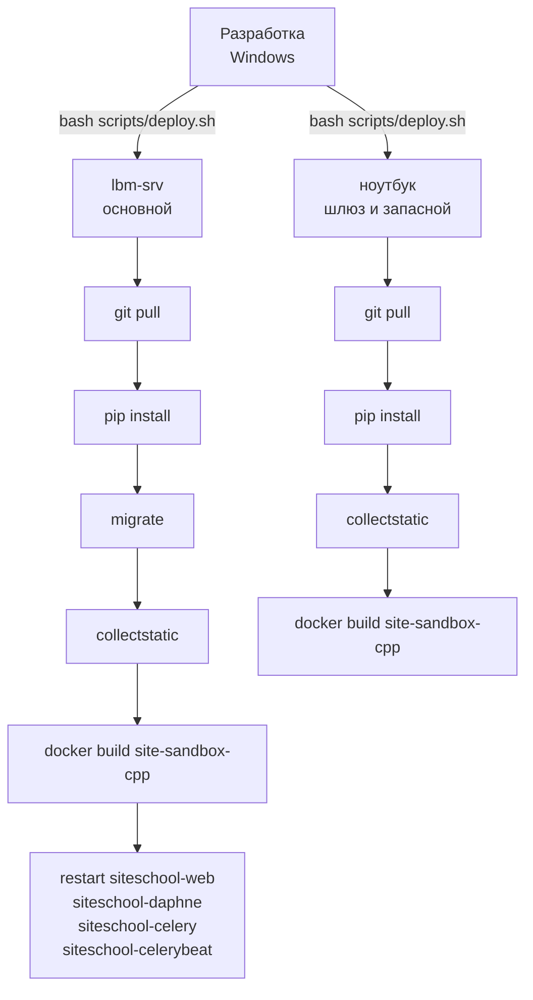

# Деплой

!!! info "Два сервера"
    Основной сервер – lbm-srv, ноутбук – шлюз и запасной. Общая схема и авария
    описаны в **[«Два сервера»](../two-servers.md)**.

## Процесс деплоя

Выкатка идёт с dev из Git Bash одной командой: `scripts/deploy.sh` заходит по
SSH на оба сервера. lbm-srv получает полный деплой, ноутбук – только код и
статику.



## Запуск

```bash
bash scripts/deploy.sh
```

Скрипт отказывается работать, если на ноутбуке стоит флаг
`/home/admin/site/.failover`: в этом режиме основной сервер – ноутбук, и эта
схема выкатки к нему не подходит.

### Что делает скрипт на lbm-srv

```bash
cd ~/siteSchool
git pull --ff-only
venv/bin/pip install -q -r requirements.txt
venv/bin/python manage.py migrate --noinput
venv/bin/python manage.py collectstatic --noinput
docker build -q -t site-sandbox-cpp docker/sandbox-cpp
sudo systemctl restart siteschool-web siteschool-daphne siteschool-celery siteschool-celerybeat
```

### Что делает скрипт на ноутбуке

```bash
cd ~/site
git pull --ff-only
venv/bin/pip install -q -r requirements.txt
venv/bin/python manage.py collectstatic --noinput
docker build -q -t site-sandbox-cpp docker/sandbox-cpp
```

`migrate` на ноутбуке не выполняется: схема приходит репликой, запись в реплику
невозможна. Сервисы сайта не перезапускаются – в обычном режиме они выключены.

## Пересборка Tailwind CSS

Если в коммите менялись HTML-шаблоны или `tailwind.config.js`, CSS
пересобирается локально до деплоя и коммитится в репозиторий. На серверах
дополнительных действий не требуется – `static/css/tailwind.css` уже актуален.

```bash
npm run tw:build
```

!!! info "Node.js"
    Требуется Node.js с установленными зависимостями (`npm install`). Tailwind v3.4+ установлен в `devDependencies`.

## Верификация

```bash
# Сервисы lbm-srv
ssh lih@lbm-srv 'systemctl status siteschool-web siteschool-daphne siteschool-celery siteschool-celerybeat nginx redis-server postgresql@16-siteschool --no-pager'

# Ошибки после выкладки
ssh lih@lbm-srv 'journalctl -u siteschool-web --since "5 minutes ago"'
ssh lih@lbm-srv 'journalctl -u siteschool-daphne --since "5 minutes ago"'
ssh lih@lbm-srv 'journalctl -u siteschool-celery --since "5 minutes ago"'

# Redis
ssh lih@lbm-srv 'redis-cli ping'   # → PONG
```

Проверка реплики после выкладки с миграциями – в
[«Два сервера»](../two-servers.md#проверка-реплики).

!!! tip "Nginx"
    Nginx перезапускать обычно не нужно – конфигурация меняется редко. При изменении конфига: `sudo nginx -t && sudo systemctl reload nginx`.

## Выкладка данных и медиа

Код и схема БД едут `deploy.sh`. Данные и медиа выкладываются отдельно, и
порядок внутри них важен – медиа строго до загрузчиков, пулы после банков:

- **[Банк ЕГЭ](../ege-bank-deploy.md)** – `media/ege/bank-*`, затем `load_ege`,
  `seed_ege_tasks` и `ege_pools`;
- **[Симуляции спецкурса](../spetskurs-deploy.md)** – собранные `.wasm` и архив
  исходников, выпуск разборов через `publish_spetskurs`.

Оба артефакта в git не хранятся: в `.gitignore` стоят `media/`, `fixtures/*`,
собранные `static/spetskurs/wasm/*.{html,js,wasm}` и архив
`static/spetskurs/*.zip`. Переносят их вручную, на **оба** сервера: lbm-srv
отдаёт их ученикам, ноутбук должен быть готов к аварии. Медиа на ноутбук,
кроме того, каждые 10 минут подтягивает крон пользователя admin с lbm-srv.

## Откат

При проблемах после деплоя:

```bash
# 1. Откат кода на lbm-srv
ssh lih@lbm-srv
cd /home/lih/siteSchool
git log --oneline -5          # найти предыдущий коммит
git checkout <commit-hash>    # откатиться

# 2. Откат миграции (если применена)
venv/bin/python manage.py migrate <app_name> <previous_migration>

# 3. Перезапуск
sudo systemctl restart siteschool-web siteschool-daphne siteschool-celery siteschool-celerybeat
```

Ноутбук откатывается так же, но без `migrate` и без перезапуска сервисов.

## Импорт тестов

Для загрузки новых тестов из JSON-фикстур:

```bash
python manage.py load_quiz fixtures/my_quiz.json
```

Шаблон формата: `fixtures/quiz_template.json`. Поддерживает все 3 типа вопросов: `choice`, `text`, `code`.

Банки ЕГЭ грузятся отдельной командой – `python manage.py load_ege fixtures/bank-05.json`; её место в общем порядке выкладки описано в [выкладке банка ЕГЭ](../ege-bank-deploy.md).

## SSL-сертификат

Сертификат Let's Encrypt стоит на ноутбуке, в nginx шлюза. Certbot обновляет
его автоматически. Проверка:

```bash
ssh admin@192.168.1.199 -p 2222
sudo certbot renew --dry-run
```

## Окружение (.env)

На lbm-srv секреты хранятся в `/home/lih/siteSchool/.env`:

| Переменная | Описание |
|------------|----------|
| `SECRET_KEY` | Django secret key |
| `DEBUG` | `False` на production (значение сравнивается со строкой `'True'`) |
| `DB_NAME`, `DB_USER`, `DB_PASSWORD`, `DB_HOST`, `DB_PORT` | Подключение к PostgreSQL: кластер `16/siteschool`, порт 5433 |
| `CELERY_BROKER_URL`, `CELERY_RESULT_BACKEND` | Redis для Celery, база 1 |
| `CHANNELS_REDIS_URL` | Redis для Channels, база 2 |
| `YANDEX_METRIKA_ID` | Номер счётчика Яндекс.Метрики. Задаётся только на production: пусто – счётчик не выводится |

На ноутбуке свой `.env` в `/home/admin/site/.env`: `DB_NAME=siteschool`,
`DB_USER=siteschool`, пароль тот же, что на lbm-srv, `DB_HOST=localhost`,
`DB_PORT=5432` – это своя реплика. Роли приходят репликой.

`ALLOWED_HOSTS` из `.env` не читается – список хостов задан прямо в `config/settings.py`.

!!! danger "Безопасность"
    `.env` файл **не** коммитится в Git. Содержит приватные ключи и credentials.
