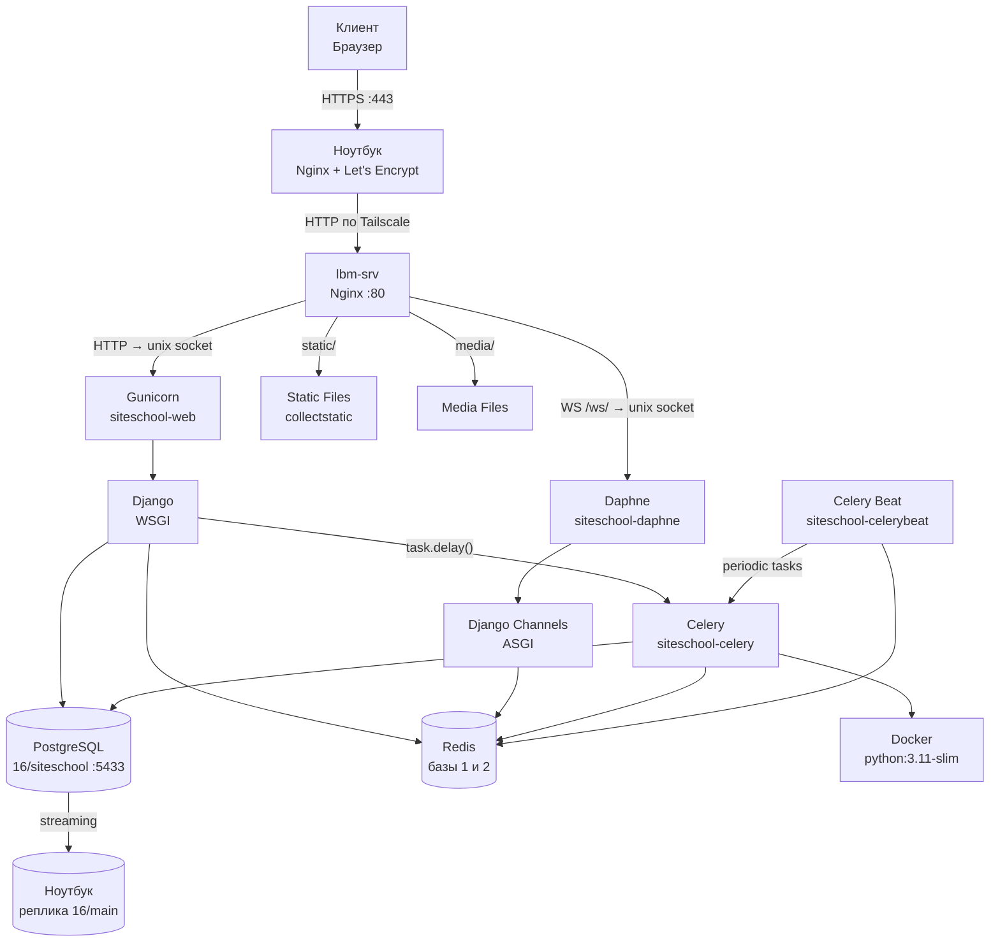

# Сервер

!!! info "Два сервера"
    Прод переехал: основной сервер – lbm-srv, ноутбук остался шлюзом и запасным.
    Общая схема, авария и возврат описаны в **[«Два сервера»](../two-servers.md)**.

## Общая архитектура

Интернет приходит на ноутбук: там nginx с сертификатом Let's Encrypt. Дальше
nginx проксирует запросы по Tailscale на lbm-srv, где работает Django и всё
остальное. lbm-srv слушает только свой Tailscale-адрес и в интернет не смотрит.



## Характеристики серверов

### lbm-srv – основной

| Параметр | Значение |
|----------|----------|
| **Хост** | lbm-srv |
| **Tailscale** | 100.65.27.51 |
| **ОС** | Ubuntu 24.04 |
| **Железо** | i7-12700, 32 ГБ, NVMe 1,6 ТБ |
| **Пользователь** | lih (sudo без пароля) |
| **SSH** | `ssh lih@lbm-srv` |
| **Путь проекта** | `/home/lih/siteSchool` |
| **Python venv** | `/home/lih/siteSchool/venv` |

### Ноутбук – шлюз и запасной

| Параметр | Значение |
|----------|----------|
| **Хост** | 192.168.1.199 |
| **ОС** | Ubuntu 24.04 |
| **Железо** | i5-8300H |
| **Пользователь** | admin (sudo требует пароль) |
| **SSH** | `ssh admin@192.168.1.199 -p 2222` |
| **Путь проекта** | `/home/admin/site` |
| **Роль** | nginx + Let's Encrypt; запасной сайт после `failover.sh` |

## Стек технологий

| Компонент | Версия | Назначение |
|-----------|--------|------------|
| Django | 6.0.1 | Web-фреймворк |
| PostgreSQL | 16 | Основная БД; отдельный кластер `16/siteschool` на lbm-srv, реплика на ноутбуке |
| Redis | – | Брокер Celery (база 1) и Channel Layer (база 2) |
| Celery | 5.3.6 | Async-задачи (проверка кода) |
| Django Channels | 4.0 | WebSocket |
| channels-redis | 4.2.0 | Channel Layer поверх Redis |
| Daphne | 4.1 | ASGI-сервер |
| Gunicorn | 23.0.0 | WSGI-сервер |
| WhiteNoise | 6.11.0 | Отдача статики через Django |
| Nginx | – | Шлюз на ноутбуке, reverse proxy на lbm-srv |
| Docker | 7.1.0 (py) | Sandbox для кода |
| Pillow | 12.1.0 | Обработка изображений |

## Потоки запросов

### HTTP запрос

```
Клиент → Ноутбук: nginx (:443, TLS)
       → lbm-srv: nginx (100.65.27.51:80)
       → Unix socket /run/siteschool/web.sock
       → Gunicorn (siteschool-web)
       → Django WSGI (config/wsgi.py)
       → View → Template/JSON
       → Ответ клиенту
```

### WebSocket соединение

```
Клиент → Ноутбук: nginx (:443, /ws/*)
       → lbm-srv: nginx (100.65.27.51:80)
       → Unix socket /run/siteschool/daphne.sock
       → Daphne (siteschool-daphne)
       → Django Channels ASGI (config/asgi.py)
       → QuizConsumer
       → Двусторонняя связь
```

### Статические и media файлы

```
Клиент → Ноутбук: nginx
       → lbm-srv: nginx
       → /home/lih/siteSchool/staticfiles/
       → /home/lih/siteSchool/media/
```

!!! info "Заголовки шлюза"
    nginx на lbm-srv берёт настоящий IP ученика из `X-Forwarded-For` шлюза
    (`set_real_ip_from 100.64.0.0/10`) и передаёт Django `X-Forwarded-Proto`
    шлюза (`https`), а не свой `$scheme`. Без этого сломались бы CSRF и
    редиректы.

!!! info "WhiteNoise"
    В `config/settings.py` включён `WhiteNoiseMiddleware` со `CompressedManifestStaticFilesStorage`. На проде статику отдаёт Nginx из `staticfiles/`, а WhiteNoise выручает там, где Nginx впереди нет (dev-сервер, Daphne напрямую), и отдаёт уже сжатые версии файлов. Отсюда два следствия: `collectstatic` обязателен на каждой выкладке, а манифест-хранилище требует, чтобы шаблоны ссылались на файл через `` – ссылка на несуществующий файл падает с ошибкой, а не отдаёт 404.

## Структура каталогов (lbm-srv)

```
/home/lih/siteSchool/
├── config/              # Django settings, urls, wsgi, asgi
├── accounts/            # App: пользователи
├── pages/               # App: контент-страницы
├── quizzes/             # App: тесты и тренажёр ЕГЭ
├── textbook/            # App: учебник (материал, теория ЕГЭ, спецкурс)
├── spetskurs/           # App: курс численного моделирования
├── games/               # App: «Своя игра»
├── templates/           # HTML-шаблоны
├── static/              # Исходные статические файлы
│   └── spetskurs/       # Собранные WASM-симуляции (в git не хранятся)
├── staticfiles/         # collectstatic output
├── media/               # MEDIA_ROOT: загруженные файлы
│   ├── ege/             # Медиа банков и вариантов ЕГЭ
│   ├── textbook/        # Картинки статей учебника
│   ├── spetskurs/       # Иллюстрации разборов спецкурса
│   ├── games/           # Медиа «Своей игры»
│   ├── question_files/  # Файлы вопросов, question_images/ – картинки
│   └── about/ avatars/ alumni/   # Профиль автора, аватары, фото классов
├── fixtures/            # JSON для load_quiz и load_ege
├── venv/                # Python virtualenv
├── requirements.txt
├── manage.py
└── .env                 # Секреты (SECRET_KEY, доступ к БД)
```

Ноутбук держит ту же структуру в `/home/admin/site/`; в обычном режиме его
юниты `site`, `daphne`, `celery` и `celerybeat` остановлены и выключены.
