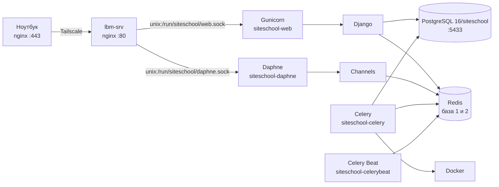

# Сервисы

!!! info "Два сервера"
    Основной сервер – lbm-srv, ноутбук – шлюз и запасной. Общая схема и авария
    описаны в **[«Два сервера»](../two-servers.md)**.

Все сервисы управляются через **systemd**. В обычном режиме сайт и всё, что его
обслуживает, работает на lbm-srv; на ноутбуке – только nginx-шлюз и Redis.

---

## Карта сервисов



---

## Nginx

### Ноутбук – шлюз

Принимает HTTPS из интернета и проксирует всё на lbm-srv через Tailscale.

| Параметр | Значение |
|----------|----------|
| **Конфиг** | `/etc/nginx/sites-available/site` (`deploy/nginx-gateway.conf`) |
| **Порты** | 80 (→ 443 redirect), 443 (SSL) |
| **SSL** | Let's Encrypt (Certbot) |
| **Upstream** | `100.65.27.51:80` |
| **Аварийный конфиг** | `/etc/nginx/sites-available/site-local` (`deploy/nginx-local.conf`) |

Символическая ссылка `/etc/nginx/sites-enabled/site` выбирает режим: обычный
шлюз или аварийный `site-local`. Если lbm-srv не отвечает 5 с или отвечает
502/503/504, шлюз отдаёт страницу обслуживания `deploy/maintenance.html`
(код 503).

### lbm-srv – reverse proxy

| Параметр | Значение |
|----------|----------|
| **Конфиг** | `/etc/nginx/sites-available/siteschool` (`deploy/nginx-lbm-srv.conf`) |
| **Адрес** | 100.65.27.51:80, только Tailscale |
| **Логи** | `/var/log/nginx/siteschool.access.log`, `/var/log/nginx/siteschool.error.log` |

| Путь | Назначение | Backend |
|------|-----------|---------|
| `/` | HTTP запросы | → `/run/siteschool/web.sock` |
| `/ws/` | WebSocket | → `/run/siteschool/daphne.sock` |
| `/static/` | Статические файлы | `/home/lih/siteSchool/staticfiles/` |
| `/media/` | Media файлы | `/home/lih/siteSchool/media/` |

`set_real_ip_from 100.64.0.0/10` возвращает настоящий IP ученика из
`X-Forwarded-For` шлюза, а `X-Forwarded-Proto` берётся у шлюза (`https`):
свой `$scheme` здесь всегда `http`.

### WASM MIME-тип

Тип `application/wasm` регистрирует Django:
`mimetypes.add_type('application/wasm', '.wasm')` в `config/settings.py`. Это
закрывает отдачу `.wasm` через Django (WhiteNoise в dev-режиме). На проде файлы
отдаёт nginx из `staticfiles/`.

### Команды

```bash
# lbm-srv
sudo nginx -t
sudo systemctl restart nginx
sudo systemctl status nginx
sudo tail -f /var/log/nginx/siteschool.error.log

# ноутбук (sudo требует пароль – только в интерактивной сессии)
systemctl is-active nginx
sudo nginx -t && sudo systemctl reload nginx
```

---

## Gunicorn (siteschool-web)

WSGI-сервер для обработки HTTP-запросов Django.

| Параметр | Значение |
|----------|----------|
| **Systemd unit** | `siteschool-web.service` |
| **Socket** | `/run/siteschool/web.sock` |
| **WSGI** | `config.wsgi:application` |
| **Воркеры** | 9 |

### Команды

```bash
sudo systemctl status siteschool-web
sudo systemctl restart siteschool-web
sudo journalctl -u siteschool-web -f
sudo journalctl -u siteschool-web --since "1 hour ago"
```

---

## Daphne (siteschool-daphne)

ASGI-сервер для WebSocket-соединений через Django Channels.

| Параметр | Значение |
|----------|----------|
| **Systemd unit** | `siteschool-daphne.service` |
| **Socket** | `/run/siteschool/daphne.sock` |
| **ASGI** | `config.asgi:application` |

### Обслуживает

- `ws/quiz/<quiz_id>/` → `QuizConsumer` (результаты кода)

Маршрут обёрнут в `AllowedHostsOriginValidator(AuthMiddlewareStack(URLRouter(...)))` (`config/asgi.py`): соединение принимается только с разрешённого хоста и доходит до консьюмера уже с текущим пользователем.

### Команды

```bash
sudo systemctl status siteschool-daphne
sudo systemctl restart siteschool-daphne
sudo journalctl -u siteschool-daphne -f
```

---

## Redis

In-memory store: брокер сообщений Celery и Channel Layer для Django Channels.

| Параметр | Значение |
|----------|----------|
| **Systemd unit** | `redis-server.service` |
| **Адрес** | `localhost:6379` |
| **DB 1** | Celery (`CELERY_BROKER_URL`, `CELERY_RESULT_BACKEND`) |
| **DB 2** | Channels (`CHANNELS_REDIS_URL`) |

### Проверка

```bash
redis-cli ping                     # → PONG
redis-cli info memory              # Использование памяти
redis-cli info clients             # Активные подключения
sudo systemctl status redis-server # Статус
```

!!! warning "Redis как single point"
    Redis используется и Celery, и Channels. Падение Redis → потеря WebSocket + остановка async-задач. Мониторьте через `redis-cli ping`.

---

## Celery (siteschool-celery)

Async worker для выполнения кода в Docker-контейнерах.

| Параметр | Значение |
|----------|----------|
| **Systemd unit** | `siteschool-celery.service` |
| **Broker** | Redis, база 1 |
| **Процессов** | 12 |
| **Очереди** | `code_execution` – `check_code_task`, `default` – остальные |
| **Конфиг** | `config/celery.py` |
| **Задачи** | `quizzes/tasks.py` |

Контейнеры песочницы запускает процесс пользователя lih: он в группе `docker`.

### Основная задача

`check_code_task(submission_id)`:

1. Получить `CodeSubmission` из БД
2. Запустить код в Docker sandbox
3. Сравнить вывод с test cases
4. Обновить результат в БД
5. Отправить уведомление через WebSocket

### Конфигурация

| Параметр | Значение |
|----------|----------|
| Concurrency | `-c 12` |
| Task time limit | 300 сек (5 мин) |
| Result expiry | 3600 сек (1 час) |
| Serializer | JSON |
| Timezone | Asia/Novosibirsk |
| Max retries | 1 |

### Команды

```bash
sudo systemctl status siteschool-celery
sudo systemctl restart siteschool-celery
sudo journalctl -u siteschool-celery -f

# Ручной запуск (для отладки)
cd /home/lih/siteSchool
source venv/bin/activate
celery -A config worker -l info
```

---

## Celery Beat (siteschool-celerybeat)

Планировщик периодических задач. Работает **только на lbm-srv**; на ноутбуке
`celerybeat` выключен и включается только `failover.sh`.

| Параметр | Значение |
|----------|----------|
| **Systemd unit** | `siteschool-celerybeat.service` |
| **Конфиг** | `config/celery.py` |

### Периодические задачи

| Задача | Интервал | Описание |
|--------|----------|----------|
| `cleanup_stale_submissions` | 30 мин | Помечает зависшие CodeSubmission (>10 мин) как error |
| `recalc_ege_difficulty_task` | 24 ч | Пересчитывает `Question.solve_rate` по фактической доле верных первых попыток (вызывает management-команду `recalc_ege_difficulty`) |

### Команды

```bash
sudo systemctl status siteschool-celerybeat
sudo systemctl restart siteschool-celerybeat
sudo journalctl -u siteschool-celerybeat -f

# Ручной запуск
celery -A config beat -l info
```

---

## PostgreSQL

Основная база данных на lbm-srv – отдельный кластер `16/siteschool` на порту
5433 (юнит `postgresql@16-siteschool`). Свой кластер, а не общий `16/main`:
физическая реплика копирует кластер целиком, и базы будущих сайтов на ноутбук
попасть не должны. Настройки кластера –
`/etc/postgresql/16/siteschool/conf.d/siteschool.conf`. PostgreSQL слушает
только localhost и Tailscale; Redis – только localhost.

На ноутбуке – streaming-реплика этого кластера в `16/main` (порт 5432), слот
репликации `siteschool_laptop`, роль `siteschool_replica`.

| Параметр | lbm-srv | ноутбук |
|----------|---------|---------|
| **Кластер** | `16/siteschool` | `16/main` |
| **Порт** | 5433 | 5432 |
| **Юнит** | `postgresql@16-siteschool` | `postgresql@16-main` |
| **Роль сайта** | `siteschool` | `siteschool` (приходит репликой) |

### Команды

```bash
sudo systemctl status postgresql@16-siteschool
sudo -u postgres psql -p 5433

# Бэкап
sudo -u postgres pg_dump -p 5433 <db_name> > backup.sql

# Восстановление
sudo -u postgres psql -p 5433 <db_name> < backup.sql
```

Проверка реплики и её пересборка – в [«Два сервера»](../two-servers.md).

---

## Docker

Sandbox для выполнения пользовательского кода.

| Параметр | Значение |
|----------|----------|
| **Образы** | `python:3.11-slim`, `site-sandbox-cpp` |
| **Timeout** | 120 сек |
| **Memory** | 128 MB |
| **CPU** | 1 ядро (quota 100000) |
| **Network** | Отключена |
| **Max output** | 64 KB |
| **Пользователь** | `nobody`, рабочий каталог `/tmp` |
| **Привилегии** | `cap_drop: ALL`, `no-new-privileges` |
| **Pids limit** | 64 процесса (потолок форк-бомбы) |
| **Потолок файла** | 64 МБ (`RLIMIT_FSIZE` в раннере – против цикла записи) |

Лимиты и флаги контейнера – константы `CONTAINER_*` в `quizzes/utils.py`; там же
раннер, который исполняет `solution.py`, замеряет CPU-время и память через
`resource.getrusage` и режет вывод. Образ `site-sandbox-cpp` собирается
`deploy.sh` из `docker/sandbox-cpp`.

### Команды

```bash
docker ps                          # Активные контейнеры
docker images                      # Доступные образы
docker system prune -f             # Очистка неиспользуемых ресурсов

# Проверить образ
docker run --rm python:3.11-slim python --version
```

!!! tip "Мониторинг контейнеров"
    При нормальной работе контейнеры живут секунды. Если `docker ps` показывает долгоживущие контейнеры – возможна утечка. `cleanup_stale_submissions` помогает, но стоит проверить логи Celery.

---

## Диагностика

### Быстрая проверка всех сервисов lbm-srv

```bash
sudo systemctl status siteschool-web siteschool-daphne siteschool-celery siteschool-celerybeat redis-server postgresql@16-siteschool nginx
```

### Полная проверка

```bash
# 1. Сервисы
for svc in nginx siteschool-web siteschool-daphne siteschool-celery siteschool-celerybeat redis-server postgresql@16-siteschool; do
  echo "=== $svc ==="
  sudo systemctl is-active $svc
done

# 2. Redis
redis-cli ping

# 3. Docker
docker info > /dev/null 2>&1 && echo "Docker OK" || echo "Docker FAIL"

# 4. Порты
ss -tlnp | grep -E '(80|5433|6379)'

# 5. Disk
df -h /home/lih/siteSchool
```

### Шлюз и реплика

```bash
# nginx шлюза
ssh admin@192.168.1.199 -p 2222 'systemctl is-active nginx'

# реплика
ssh lih@lbm-srv 'sudo -u postgres psql -p 5433 -c "select client_addr, state, write_lag, replay_lag from pg_stat_replication"'
ssh admin@192.168.1.199 -p 2222 'psql -h localhost -U siteschool -d siteschool -c "select now() - pg_last_xact_replay_timestamp() as lag"'

# флаг аварии
ssh admin@192.168.1.199 -p 2222 'test -e /home/admin/site/.failover && echo failover || echo normal'

# в норме юниты сайта на ноутбуке выключены
ssh admin@192.168.1.199 -p 2222 'systemctl is-active site daphne celery celerybeat'
```

### Частые проблемы

| Симптом | Возможная причина | Решение |
|---------|-------------------|---------|
| 502 Bad Gateway | Gunicorn/Daphne упал или lbm-srv недоступен | `sudo systemctl restart siteschool-web siteschool-daphne`; если лежит весь lbm-srv – `failover.sh` |
| Страница обслуживания | Шлюз не получил ответ от lbm-srv за 5 с | Проверить lbm-srv и Tailscale |
| WebSocket не подключается | Daphne упал или nginx неверно настроен | Проверить `journalctl -u siteschool-daphne` |
| Код не проверяется | Celery или Docker упал | `sudo systemctl restart siteschool-celery`, проверить Docker |
| Уведомления не приходят | Redis упал | `redis-cli ping`, restart redis |
| Зависшие задачи | Celery worker перезапустился | `cleanup_stale_submissions` (автоматически) |
| Нет места на диске | Docker images/containers | `docker system prune -f` |
